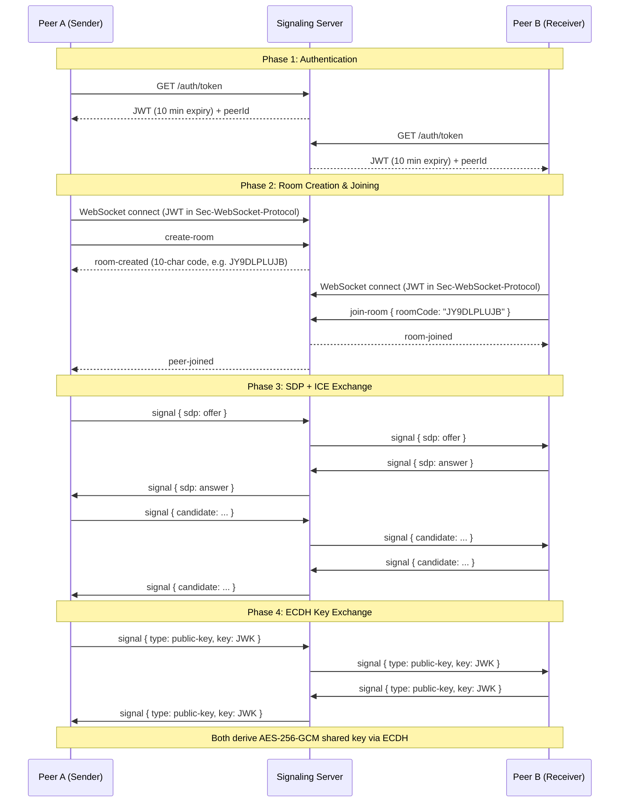

# Peer/Link — Peer-to-Peer Encrypted File Transfer

> **B.Tech Final Year Project — Computer Networks**

**Peer/Link** is a production-grade, browser-based peer-to-peer file transfer application. It uses **WebRTC** for direct device-to-device connectivity, a **Node.js WebSocket signaling server** for connection brokering, and **AES-256-GCM end-to-end encryption** so that transferred data is never readable by the server or any intermediary. When direct peer connectivity is impossible (strict firewalls, symmetric NAT), the app automatically falls back to an encrypted **WebSocket relay** through the signaling server — the server still cannot decrypt the data.

---

## Table of Contents

1. [Key Features](#-key-features)
2. [Tech Stack](#-tech-stack)
3. [High-Level Architecture](#-high-level-architecture)
4. [User Flow (Send Anywhere–Style)](#-user-flow-send-anywherestyle)
5. [Detailed Architecture & Protocol](#-detailed-architecture--protocol)
   - [Signaling Phase](#1-signaling-phase-websocket)
   - [ICE Negotiation Phase](#2-ice-negotiation-phase-stunturnice)
   - [Data Channel / Relay Phase](#3-data-channel--relay-phase)
   - [File Transfer Protocol](#4-file-transfer-protocol)
6. [Security Model](#-security-model)
7. [Project Structure & Code Walkthrough](#-project-structure--code-walkthrough)
8. [Setup & Local Development](#-setup--local-development)
9. [Running via ngrok (Cross-Network Testing)](#-running-via-ngrok-cross-network-testing)
10. [Deployment to Production](#-deployment-to-production)
11. [Environment Variables Reference](#-environment-variables-reference)
12. [Testing](#-testing)
13. [Computer Networking Concepts (Viva Preparation)](#-computer-networking-concepts-viva-preparation)
14. [Troubleshooting](#-troubleshooting)
15. [License](#-license)

---

## 🚀 Key Features

| Feature | Description |
|---------|-------------|
| **Direct P2P Transfer** | Files stream directly between browsers via WebRTC `RTCDataChannel` — zero server storage |
| **End-to-End Encryption** | ECDH P-256 key exchange + AES-256-GCM per-chunk encryption. The server never sees plaintext |
| **WebSocket Relay Fallback** | Automatic fallback when ICE/STUN/TURN fails. Encrypted chunks relay through the signaling server |
| **SHA-256 Integrity Verification** | Streaming hash computed during transfer using `hash-wasm`; receiver verifies before saving |
| **Resumable Transfers** | Receiver stores partial data in OPFS (Origin Private File System); if reconnected, transfer resumes from the last byte |
| **Batch / Folder Transfer** | Multiple files or entire folders are streamed individually and packaged into a `.zip` on the receiver side using `fflate` |
| **Send Anywhere–Style Flow** | Sender picks files → gets a 10-character room code → Receiver enters code → both verify a security fingerprint → transfer begins |
| **3D Reactive UI** | Real-time 3D scene built with React Three Fiber + GSAP that reacts to connection state and transfer progress |
| **Progressive Web App** | Installable via `vite-plugin-pwa`; works offline for the UI shell |
| **JWT Authentication** | Every WebSocket connection is authenticated with a short-lived JWT (10 min expiry) |
| **Rate Limiting** | Per-IP sliding-window rate limiting on room creation, room joining, signaling messages, and relay chunks |
| **Security Headers** | `X-Content-Type-Options`, `X-Frame-Options`, `Referrer-Policy`, `Permissions-Policy`, and HSTS in production |
| **Debug Panel** | Built-in toggleable debug panel showing timestamped ICE state, ICE gathering, candidate events, signaling events, and a "Copy Logs" button |

---

## 🧰 Tech Stack

### Client (Frontend)
| Technology | Purpose |
|-----------|---------|
| **React 19** | UI framework |
| **TypeScript** | Type safety |
| **Vite 8** | Build tool and dev server |
| **Tailwind CSS 4** | Utility-first styling |
| **Zustand** | Lightweight global state management |
| **React Three Fiber** + **Three.js** | 3D scene (Fibonacci sphere, arc beam, particle effects) |
| **GSAP** | Smooth animations and transitions |
| **Lucide React** | Icon library |
| **hash-wasm** | Streaming SHA-256 hashing (WebAssembly-accelerated) |
| **fflate** | Streaming ZIP compression/decompression in the browser |
| **Web Crypto API** | ECDH key exchange, AES-GCM encryption/decryption, SHA-256 digest |
| **OPFS (Origin Private File System)** | Disk-backed storage for large received files |
| **vite-plugin-pwa** | Service Worker & PWA manifest generation |

### Server (Backend)
| Technology | Purpose |
|-----------|---------|
| **Node.js** | Runtime |
| **Express 5** | HTTP server (health check, static files, JWT endpoint, TURN credentials) |
| **ws** | WebSocket server for signaling and relay |
| **jsonwebtoken** | JWT creation and verification |
| **cors** | Cross-Origin Resource Sharing middleware |
| **crypto** (Node built-in) | Cryptographically secure room codes, HMAC-SHA1 TURN credentials |

---

## 🏗️ High-Level Architecture

```
┌──────────────────────────────────────────────────────────────────────┐
│                         Peer A (Browser)                            │
│  ┌──────────┐  ┌──────────────┐  ┌──────────┐  ┌────────────────┐  │
│  │   React   │  │   Zustand    │  │  Crypto  │  │  WebRTCManager │  │
│  │    UI     │←→│    Store     │←→│  Module  │←→│  (webrtc.ts)   │  │
│  └──────────┘  └──────────────┘  └──────────┘  └───────┬────────┘  │
│                                                         │           │
│                            WebSocket (Signaling)        │           │
│                            RTCDataChannel (Direct P2P)  │           │
│                            WebSocket Relay (Fallback)   │           │
└─────────────────────────────────────────────────────────┼───────────┘
                                                          │
                              ┌────────────────────────────┤
                              │                            │
                    ┌─────────▼──────────┐       ┌────────▼─────────┐
                    │  Signaling Server   │       │   STUN / TURN    │
                    │  (Node.js + ws)     │       │   Servers         │
                    │  Port 8080          │       │   (Google, etc.)  │
                    └─────────▲──────────┘       └──────────────────┘
                              │
                              │
┌─────────────────────────────┼───────────────────────────────────────┐
│                         Peer B (Browser)                            │
│  ┌──────────┐  ┌──────────────┐  ┌──────────┐  ┌────────────────┐  │
│  │   React   │  │   Zustand    │  │  Crypto  │  │  WebRTCManager │  │
│  │    UI     │←→│    Store     │←→│  Module  │←→│  (webrtc.ts)   │  │
│  └──────────┘  └──────────────┘  └──────────┘  └────────────────┘  │
└──────────────────────────────────────────────────────────────────────┘
```

---

## 📱 User Flow (Send Anywhere–Style)

```
  SENDER                                              RECEIVER
  ──────                                              ────────
  1. Click "Send"                                     1. Click "Receive"
  2. Pick file(s) or folder                           2. Enter 10-char room code
  3. Room code appears (e.g. JY9DLPLUJB)              3. Connection established
  4. Share code with receiver                         4. Security fingerprint shown
  5. Security fingerprint shown                       5. Click "I verified this code"
  6. Click "I verified this code"                     6. Review file offer → Accept
  7. Transfer begins automatically                    7. File downloads when verified
  8. SHA-256 verification result shown                8. ✅ or ❌ shown
```

---

## 🔬 Detailed Architecture & Protocol

### 1. Signaling Phase (WebSocket)

The signaling server's only job is to **broker the introduction** between two peers. It never sees any file data.



**Room code format:** 10 characters from alphabet `ABCDEFGHJKLMNPQRSTUVWXYZ23456789` (excludes visually ambiguous 0, O, 1, I). Code space = 32¹⁰ ≈ 1.07 billion possible codes (≈50 bits of entropy). Generated using `crypto.randomInt()` (CSPRNG).

**WebSocket messages** (server → client):
| Message Type | Payload | Description |
|-------------|---------|-------------|
| `room-created` | `{ roomCode, role }` | Room created, sender gets code |
| `room-joined` | `{ roomCode, role }` | Receiver joined the room |
| `peer-joined` | — | Notifies sender that receiver arrived |
| `peer-left` | — | Notifies when the other peer disconnects |
| `signal` | `{ payload }` | Relayed signaling data (SDP, ICE, keys, relay chunks) |
| `ping` | — | Server heartbeat (every 10s) |
| `error` | `{ message }` | Rate limit exceeded, room not found, etc. |

### 2. ICE Negotiation Phase (STUN/TURN/ICE)

After SDP offer/answer exchange, the browser's ICE agent gathers candidates:

1. **Host candidates** — local network IP addresses (e.g., `192.168.1.5:64933`)
2. **Server-reflexive (srflx) candidates** — public IP discovered via STUN (e.g., `152.57.185.93:62863`)
3. **Relay candidates** — allocated by a TURN server (if configured)

The ICE agent then performs **connectivity checks** by sending STUN Binding Requests between all candidate pairs. The first pair that succeeds is used.

**ICE state machine in the app:**
```
new → checking → connected ✓  (direct P2P works!)
                → failed ✗    (triggers relay fallback)
                → disconnected (8s timeout → relay fallback)
```

**Fallback logic (client/src/lib/webrtc.ts):**
- If `iceConnectionState` stays in `checking` for 8 seconds → `fallbackToRelay()`
- If `iceConnectionState` reaches `failed` or `disconnected` → `fallbackToRelay()`
- Global 12-second timeout from the moment peers see each other → `fallbackToRelay()`
- All fallback paths converge on `fallbackToRelay()` which closes the `RTCPeerConnection` and marks the WebSocket as the data transport

### 3. Data Channel / Relay Phase

**Direct mode (WebRTC):** Binary `ArrayBuffer` chunks sent over `RTCDataChannel` with `ordered: true`.

**Relay mode (WebSocket fallback):** The same encrypted binary chunks are base64-encoded and sent as JSON through the signaling server:
```json
{ "type": "signal", "payload": { "relayType": "chunk", "data": "<base64>" } }
```
Application-level messages (file-meta, file-done, etc.) use:
```json
{ "type": "signal", "payload": { "relayType": "app", "data": { "type": "file-meta", ... } } }
```

**Backpressure control:**
- `BUFFER_THRESHOLD = 64KB` — if `dc.bufferedAmount` or `ws.bufferedAmount` exceeds this, the sender pauses and waits for the buffer to drain before sending the next chunk
- WebRTC uses the `bufferedamountlow` event; relay mode polls every 50ms

### 4. File Transfer Protocol

All application messages are sent over the data channel (or relay). The protocol is:

```
SENDER                                          RECEIVER
──────                                          ────────
  ── file-offer { name, size, mime } ──────────→
                                      ← accept-transfer ──
  ── file-meta { name, size, mime, hash, path } ──────────→
                                      ← file-offset { offset } ──
  ── [encrypted chunk 1] ─────────────────────→
  ── [encrypted chunk 2] ─────────────────────→
  ── ...                  ─────────────────────→
  ── [encrypted chunk N] ─────────────────────→
  ── file-done ───────────────────────────────→
                                      ← file-result { verified, receivedSize } ──
```

**For batch/folder transfers:**
```
  ── batch-offer { name, size, totalFiles, mime } ─→
                                      ← accept-transfer ──
  ── batch-meta { name, totalSize, totalFiles } ───→
  ── [file 1: file-meta → chunks → file-done] ────→
                                      ← file-result ──
  ── [file 2: file-meta → chunks → file-done] ────→
                                      ← file-result ──
  ── batch-done ───────────────────────────────────→
```

The receiver streams each file into a ZIP archive using `fflate` (`ZipPassThrough`), storing it in OPFS. The final `.zip` is offered for download.

**Chunk format:**
```
[12-byte IV][AES-GCM ciphertext + 16-byte auth tag]
```
Each chunk is 16KB of plaintext (CHUNK_SIZE = 16384), encrypted individually with a random 12-byte IV.

---

## 🔐 Security Model

### End-to-End Encryption (E2EE)

```
┌────────────────────────────────────────────────────────────────────┐
│  Key Exchange: ECDH (Elliptic Curve Diffie-Hellman) over P-256    │
│  ─────────────────────────────────────────────────────────────── │
│  1. Each peer generates an ephemeral ECDH key pair (P-256)        │
│  2. Public keys are exchanged via the signaling server (JWK)      │
│  3. Each peer derives the SAME shared secret via ECDH             │
│  4. Shared secret is used to derive an AES-256-GCM key            │
│  5. All file data is encrypted with AES-GCM before transmission   │
│                                                                    │
│  Result: The signaling server sees only public keys and           │
│  encrypted ciphertext — it CANNOT decrypt any file data.          │
└────────────────────────────────────────────────────────────────────┘
```

### Security Fingerprint

After key exchange, both peers compute a **security fingerprint** from both public keys:
```
SHA-256(sorted(JSON(localPubKey) + JSON(remotePubKey)))
```
Displayed as `A1B2-C3D4-E5F6-G7H8-...` — both peers must visually verify this matches out-of-band to prevent MITM attacks. The transfer cannot begin until the user clicks "I verified this code".

### Integrity Verification

1. **SHA-256 file hash** — computed by the sender using streaming `hash-wasm` (4MB chunks to prevent event-loop starvation), sent in `file-meta`
2. **Streaming hash on receive** — receiver incrementally hashes each decrypted chunk during transfer
3. **Post-transfer verification** — receiver compares computed hash vs expected hash
4. **AES-GCM authentication** — each individual chunk is authenticated by AES-GCM's 16-byte auth tag; any tampering causes immediate decryption failure

### Server-Side Security

| Measure | Implementation |
|---------|---------------|
| **JWT Authentication** | 10-minute expiry tokens, required for WebSocket connection |
| **Rate Limiting** | Per-IP, per-action sliding window (10 rooms/min, 30 joins/min, 10000 relay chunks/min) |
| **Payload Validation** | `isValidSignalPayload()` validates SDP, ICE candidate, public key, and relay data structure and size |
| **Max WebSocket Payload** | 64KB limit prevents memory exhaustion |
| **Room Code Entropy** | 50 bits via `crypto.randomInt()` (CSPRNG) |
| **Security Headers** | `X-Content-Type-Options: nosniff`, `X-Frame-Options: DENY`, `Referrer-Policy: no-referrer`, `Permissions-Policy`, HSTS |
| **CORS** | Configurable allowed origins via `CLIENT_ORIGINS` env var |
| **Heartbeat** | 10-second ping/pong; dead connections are terminated |

---

## 📁 Project Structure & Code Walkthrough

```
CN-project/
├── client/                          # React frontend (Vite + TypeScript)
│   ├── src/
│   │   ├── components/
│   │   │   ├── Interface.tsx        # Main UI: Home, Send, Receive, Transfer, Debug panel
│   │   │   ├── PeerLink.tsx         # 3D scene: Fibonacci sphere, arc beam, particles
│   │   │   └── Scene.tsx            # React Three Fiber canvas wrapper
│   │   ├── lib/
│   │   │   ├── webrtc.ts            # WebRTCManager class: signaling, ICE, data channel,
│   │   │   │                        #   relay fallback, file chunking, batch transfer, OPFS
│   │   │   └── crypto.ts            # ECDH key gen, AES-GCM encrypt/decrypt, SHA-256
│   │   │                            #   streaming hash, security fingerprint
│   │   ├── store/
│   │   │   └── useStore.ts          # Zustand store: connection status, transfer state,
│   │   │                            #   flow state, debug logs, security fingerprint
│   │   ├── App.tsx                  # Root component
│   │   ├── App.css                  # Global styles and CSS variables
│   │   ├── index.css                # Tailwind imports
│   │   └── main.tsx                 # React DOM entry point
│   ├── public/                      # Static assets (favicon, icons)
│   ├── vite.config.ts               # Vite config: React, Tailwind, PWA plugins
│   ├── package.json                 # Dependencies and scripts
│   └── tsconfig.json                # TypeScript configuration
│
├── server/                          # Node.js signaling server
│   ├── index.js                     # Express + WebSocket server: JWT auth, room management,
│   │                                #   signal relay, rate limiting, heartbeat, TURN credentials
│   ├── .env.example                 # Environment variable template
│   ├── test_signaling.js            # Automated signaling protocol test
│   ├── test_turn.js                 # TURN server connectivity test
│   ├── package.json                 # Dependencies and scripts
│   └── tsconfig.json                # TypeScript config (for type references)
│
├── docs/                            # Documentation
│   ├── ARCHITECTURE.md              # Detailed architecture document
│   ├── NETWORK_SECURITY_AUDIT.md    # Security audit findings
│   ├── TECHNICAL_AUDIT.md           # Technical audit
│   └── ROADMAP.md                   # Feature roadmap
│
├── render.yaml                      # Render.com deployment configuration
└── README.md                        # This file
```

### Key Files Explained

#### `client/src/lib/webrtc.ts` — The Core Engine (~1070 lines)

This is the heart of the application. The `WebRTCManager` class handles:

- **`connectSignaling()`** — Fetches a JWT from `/auth/token`, opens a WebSocket to the signaling server using the JWT in `Sec-WebSocket-Protocol`
- **`setupPeerConnection()`** — Creates `RTCPeerConnection` with ICE servers, sets up data channel, registers ICE/signaling handlers, initiates ECDH key exchange
- **`createOffer()` / `handleSignal()`** — SDP offer/answer exchange and ICE candidate processing with queuing (handles candidates arriving before remote description)
- **`fallbackToRelay()`** — Closes WebRTC, marks `isRelayed = true`, and reuses the WebSocket for encrypted chunk relay
- **`sendFile()` / `sendFiles()`** — Hashes the file, sends metadata, waits for receiver offset (resume support), then streams encrypted chunks with backpressure control
- **`processMessageQueue()`** — Sequential message processor for received chunks: decrypts, hashes, writes to OPFS or ZIP stream, updates progress
- **`finishReceive()`** — Closes OPFS writable, verifies hash, triggers download, cleans up partial files

#### `client/src/lib/crypto.ts` — Cryptographic Operations

- **`generateECDHKeyPair()`** — Generates P-256 ECDH key pair using Web Crypto API
- **`deriveAESKey()`** — Derives AES-256-GCM key from ECDH shared secret
- **`encryptChunk()`** — Encrypts data with a random 12-byte IV, returns `[IV || ciphertext || tag]`
- **`decryptChunk()`** — Extracts IV, decrypts, and authenticates in one operation
- **`hashFileStream()`** — Streams file through SHA-256 in 4MB chunks, yielding to the event loop between chunks
- **`fingerprintPublicKeys()`** — Computes deterministic fingerprint from both peers' public keys

#### `client/src/store/useStore.ts` — State Management

Zustand store managing:
- **`flowState`**: `home` → `send-pick` → `send-wait` / `receive-input`
- **`connectionStatus`**: `idle` → `creating` → `waiting` → `connecting` → `connected` / `failed` / `disconnected`
- **`transfer`**: `{ direction, fileName, fileSize, bytesTransferred, verified, stage, batchTotalFiles, batchCurrentIndex }`
- **`debugLogs`**: Timestamped array for the debug panel
- **`securityFingerprint`** and **`securityVerified`**: ECDH fingerprint verification state

#### `client/src/components/Interface.tsx` — User Interface

Renders different screens based on `flowState` and `connectionStatus`:
- **Home**: Send / Receive buttons
- **Send Pick**: File picker (click or drag-and-drop) + folder picker via `webkitdirectory`
- **Send Wait**: Shows room code, waits for receiver
- **Receive Input**: Room code input field
- **Transfer Screen**: File name, progress bar, speed, verification result
- **Debug Panel**: Toggleable panel with timestamped logs and "Copy" button

#### `client/src/components/PeerLink.tsx` — 3D Visualization

React Three Fiber component featuring:
- **Fibonacci sphere** of 500 points (golden-angle distribution)
- **Two nodes** (sender/receiver) that pulse and change color based on connection state
- **Arc beam** between nodes that animates during transfer
- **Particle system** with velocity-based movement

#### `server/index.js` — Signaling Server

Express + ws server handling:
- **`GET /health`** — Health check endpoint
- **`GET /auth/token`** — Issues JWTs with `crypto.randomUUID()` peer IDs
- **`GET /turn-credentials`** — Returns ICE server config (STUN + TURN with HMAC-SHA1 time-limited credentials in production, or public fallback in development)
- **WebSocket `create-room`** — Generates room code, creates room `Map` entry
- **WebSocket `join-room`** — Validates code format, checks room exists and isn't full, notifies owner
- **WebSocket `signal`** — Validates payload structure and relays to the other peer in the room
- **Heartbeat** — Pings all clients every 10 seconds, terminates unresponsive connections
- **Static file serving** — Serves the built client from `../client/dist`

---

## 🛠️ Setup & Local Development

### Prerequisites

- **Node.js** ≥ 18 (with npm)
- **ngrok** (for cross-network testing) — [download](https://ngrok.com/download)

### 1. Clone the Repository

```bash
git clone <your-repo-url>
cd CN-project
```

### 2. Install Dependencies

```bash
# Server
cd server
npm install

# Client
cd ../client
npm install
```

### 3. Start the Signaling Server

```bash
cd server
npm run dev        # Uses --watch for auto-restart
# OR
npm run start      # node index.js
```

The server starts on **`http://localhost:8080`** and serves the built client static files.

### 4. Start the Client Dev Server (for development)

```bash
cd client
npm run dev
```

The Vite dev server starts on **`http://localhost:5173`** with hot module replacement.

### 5. Build the Client for Production

```bash
cd client
npm run build
```

Output goes to `client/dist/`. The signaling server (`server/index.js`) serves this directory as static files.

---

## 🌐 Running via ngrok (Cross-Network Testing)

To test between devices on different networks (e.g., your laptop and your phone on mobile data):

### 1. Build the client and start the server

```bash
cd client && npm run build
cd ../server && node index.js
```

### 2. Start ngrok

```bash
ngrok http 8080
# Or with a stable domain:
ngrok http 8080 --url https://your-domain.ngrok-free.dev
```

### 3. Use the ngrok URL

Open the **https** ngrok URL on both devices. The client auto-detects the signaling server URL from `window.location`, so no environment variables are needed.

> **Note:** On the first visit, ngrok free tier shows an interstitial page — click "Visit Site" to proceed.

---

## 🚢 Deployment to Production

### Option 1: Render.com (render.yaml included)

The project includes a `render.yaml` for one-click deployment:

```yaml
services:
  - type: web
    name: peerlink-signaling-server
    env: node
    buildCommand: npm install
    startCommand: node index.js
    envVars:
      - key: NODE_ENV
        value: production
      - key: PORT
        value: 10000
    rootDir: server
```

**Required environment variables in Render dashboard:**
- `JWT_SECRET` — A strong random secret (e.g., `openssl rand -base64 32`)
- `TURN_URL` — Your TURN server URL (e.g., `turn:your-turn-server.com:443`)
- `TURN_SECRET` — Your TURN server shared secret
- `CLIENT_ORIGINS` — Your frontend origin (e.g., `https://peerlink.example.com`)

### Option 2: Manual Deployment

1. Build the client: `cd client && npm run build`
2. Deploy `server/` with `client/dist/` accessible at `../client/dist` relative to the server
3. Set required environment variables
4. Run `node index.js`

### Deployment Checklist

- [ ] `NODE_ENV=production` is set
- [ ] `JWT_SECRET` is set to a strong random value
- [ ] `TURN_URL` and `TURN_SECRET` are configured for a real TURN server
- [ ] `CLIENT_ORIGINS` is set to the exact frontend HTTPS origin
- [ ] The host supports persistent WebSocket connections
- [ ] HTTPS is enabled (required for WebRTC in browsers)

---

## ⚙️ Environment Variables Reference

### Server (`server/.env`)

| Variable | Default | Description |
|----------|---------|-------------|
| `PORT` | `8080` | Server listen port |
| `JWT_SECRET` | `dev-jwt-secret` | Secret for signing JWTs. **Must be set in production.** |
| `NODE_ENV` | — | Set to `production` to enforce JWT_SECRET and TURN requirements |
| `CLIENT_ORIGINS` | `http://localhost:5173,...` | Comma-separated allowed CORS origins |
| `RATE_LIMIT_PER_MINUTE` | `10` | Max room creations per IP per minute |
| `RELAY_CHUNKS_PER_MINUTE` | `10000` | Max relay chunks per IP per minute |
| `HEARTBEAT_INTERVAL_MS` | `10000` | WebSocket heartbeat interval |
| `TURN_URL` | — | TURN server URL (e.g., `turn:turn.example.com:443`) |
| `TURN_SECRET` | — | TURN server shared secret for HMAC-SHA1 credentials |

### Client

| Variable | Default | Description |
|----------|---------|-------------|
| `VITE_SIGNALING_URL` | Auto-detected from `window.location` | WebSocket URL of the signaling server |

---

## 🧪 Testing

### Automated Signaling Test

```bash
cd server
npm test           # Runs test_signaling.js
```

Tests the signaling protocol: room creation, joining, signal relay, error cases.

### TURN Server Connectivity Test

```bash
cd server
node test_turn.js
```

### End-to-End Playwright Test

```bash
cd client
npx playwright test
```

Tests the full multi-tab transfer flow in a browser.

### Manual Cross-Device Test

1. Start server + ngrok
2. Open ngrok URL on Device A (laptop browser)
3. Open ngrok URL on Device B (phone browser)
4. Device A: Send → pick file → get room code
5. Device B: Receive → enter room code
6. Both: Verify security fingerprint
7. Device B: Accept transfer
8. Verify the file downloads correctly with ✅

---

## 🧠 Computer Networking Concepts (Viva Preparation)

### What is WebRTC?

**Web Real-Time Communication (WebRTC)** is an open-source project (maintained by Google) that provides browsers and mobile apps with real-time communication via simple JavaScript APIs. It enables peer-to-peer audio, video, and arbitrary data sharing without plugins.

Key APIs used in this project:
- **`RTCPeerConnection`** — Manages the P2P connection, ICE negotiation, and DTLS-SRTP encryption
- **`RTCDataChannel`** — A bidirectional data channel for arbitrary data (our file chunks)
- **`RTCSessionDescription`** — Wraps SDP offers and answers

### What is SDP (Session Description Protocol)?

**SDP** is a text-based format (RFC 8866) describing multimedia session parameters. In WebRTC, SDP carries:
- Media capabilities (codecs, formats)
- Transport addresses (IP:port candidates)
- Security parameters (DTLS fingerprints)
- Data channel configuration

The **offer/answer model**: Peer A creates an SDP offer describing what it supports, Peer B responds with an SDP answer accepting compatible parameters.

### What is ICE (Interactive Connectivity Establishment)?

**ICE** (RFC 8445) is a framework for finding the best path between two peers. It:
1. Gathers **candidates** (possible IP:port pairs) from multiple sources
2. Pairs them up and tests connectivity
3. Selects the best working pair

**Candidate types:**
| Type | Source | Example | Priority |
|------|--------|---------|----------|
| **host** | Local network interface | `192.168.1.5:64933` | Highest |
| **srflx** (server-reflexive) | STUN server response | `152.57.185.93:62863` | Medium |
| **relay** | TURN server allocation | `74.125.250.1:12345` | Lowest |

### What is NAT (Network Address Translation)?

**NAT** maps multiple private IP addresses (e.g., `192.168.x.x`) to a single public IP. Types:

| NAT Type | Behavior | P2P Possible? |
|----------|----------|---------------|
| **Full Cone** | Any external host can send to the mapped port | Yes (easy) |
| **Address-Restricted Cone** | Only hosts the internal sent to can reply | Yes (with STUN) |
| **Port-Restricted Cone** | Only the exact host:port the internal sent to can reply | Yes (with STUN) |
| **Symmetric** | Different mapping for each destination | No (needs TURN) |

### What is STUN (Session Traversal Utilities for NAT)?

**STUN** (RFC 5389) is a lightweight protocol that allows a client behind NAT to discover:
- Its **public IP address**
- Its **public port mapping**
- The **type of NAT** it's behind

The client sends a Binding Request to the STUN server; the server responds with the observed source IP:port. This project uses Google's public STUN servers (`stun:stun.l.google.com:19302`).

### What is TURN (Traversal Using Relays around NAT)?

**TURN** (RFC 5766) is a relay protocol used when direct connectivity fails (symmetric NAT, strict firewalls). The TURN server allocates a public relay address and forwards all traffic between peers.

**TURN credential generation in this project:**
```javascript
const ttl = 60 * 60; // 1 hour
const username = `${Math.floor(Date.now() / 1000) + ttl}:peerlink`;
const password = crypto.createHmac('sha1', TURN_SECRET).update(username).digest('base64');
```
This generates time-limited credentials using HMAC-SHA1, compatible with coturn and most TURN servers.

### What is DTLS-SRTP?

**DTLS (Datagram Transport Layer Security)** is TLS over UDP. WebRTC mandates DTLS-SRTP for all media and data channels, providing:
- **Encryption** — All WebRTC traffic is encrypted at the transport layer
- **Authentication** — DTLS fingerprints in SDP prevent MITM at the transport level
- **Note:** Our app adds an additional layer of AES-GCM encryption on top of DTLS for true end-to-end encryption (the signaling server could theoretically MITM the DTLS layer)

### What are WebSockets?

**WebSockets** (RFC 6455) provide full-duplex, persistent TCP connections between browser and server. Unlike HTTP (request-response), WebSockets allow the server to push messages to the client at any time.

Used in this project for:
1. **Signaling** — Exchanging SDP and ICE candidates
2. **Heartbeat** — Server sends `ping`, client responds `pong`
3. **Relay fallback** — When WebRTC fails, encrypted file chunks are relayed through the WebSocket

### What is the Difference Between TCP and UDP?

| Feature | TCP | UDP |
|---------|-----|-----|
| **Connection** | Connection-oriented (3-way handshake) | Connectionless |
| **Reliability** | Guaranteed delivery, ordering | Best-effort, no ordering |
| **Flow Control** | Yes (sliding window) | No |
| **Use Case** | HTTP, WebSocket, file transfer | VoIP, gaming, STUN/TURN |

WebRTC uses **SCTP over DTLS over UDP** for data channels, providing reliable ordered delivery (like TCP) but over UDP for NAT traversal benefits.

### Key Port Numbers

| Protocol | Port | Used For |
|----------|------|----------|
| HTTP | 80 | TURN (UDP fallback) |
| HTTPS | 443 | TURN over TLS, ngrok tunnel |
| STUN | 19302 | Google STUN servers |
| WebSocket | 8080 | Signaling server (local dev) |

---

## 🔧 Troubleshooting

### "ICE connection failed / timed out"

This means direct P2P connectivity failed. The app should automatically fall back to WebSocket relay. If the fallback also fails:
1. Check that both devices can reach the signaling server (open the URL in a browser)
2. Check the Debug Panel for ICE candidate types — if you only see `host` candidates, STUN may be blocked
3. Ensure HTTPS is being used (WebRTC requires secure contexts)

### "Receiver reported a hash mismatch"

This indicates data corruption during transfer. Possible causes:
1. Network instability causing dropped WebSocket frames
2. Browser memory pressure on very large files
3. Check the debug panel for the `receivedSize` — if it's less than the file size, chunks were dropped

### "Origin not allowed" errors in server logs

The CORS configuration doesn't include your origin. The server allows:
- `localhost` and `127.0.0.1`
- Any `*.ngrok-free.dev`, `*.ngrok-free.app`, `*.ngrok.io` domain
- Origins listed in the `CLIENT_ORIGINS` environment variable

### Connection stuck on "Connecting..."

1. Open the Debug Panel and check ICE state events
2. If stuck on `checking`, the app will automatically fallback after 8 seconds
3. If no candidates appear, WebSocket connectivity to the signaling server may be blocked

---

## 📄 License

This project is part of a B.Tech Computer Networks final year project.
